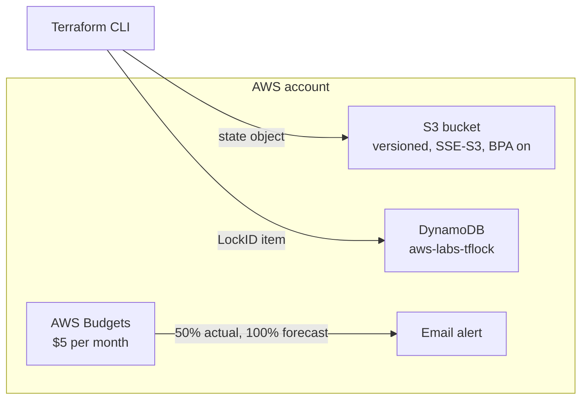
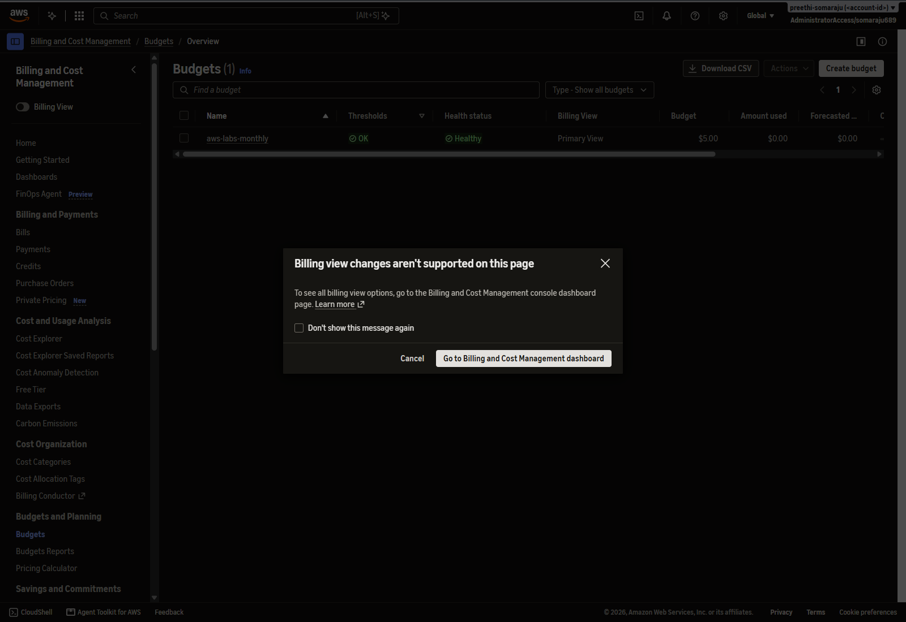
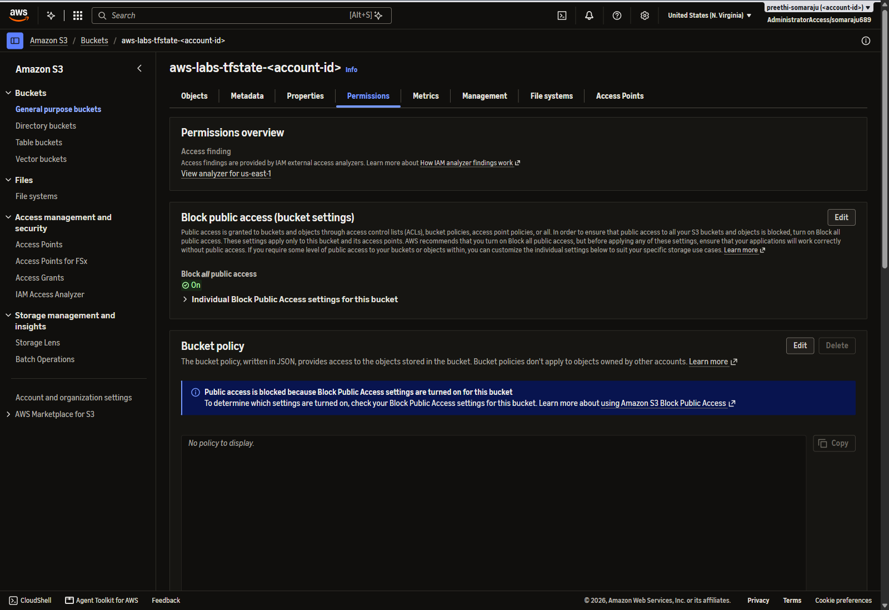
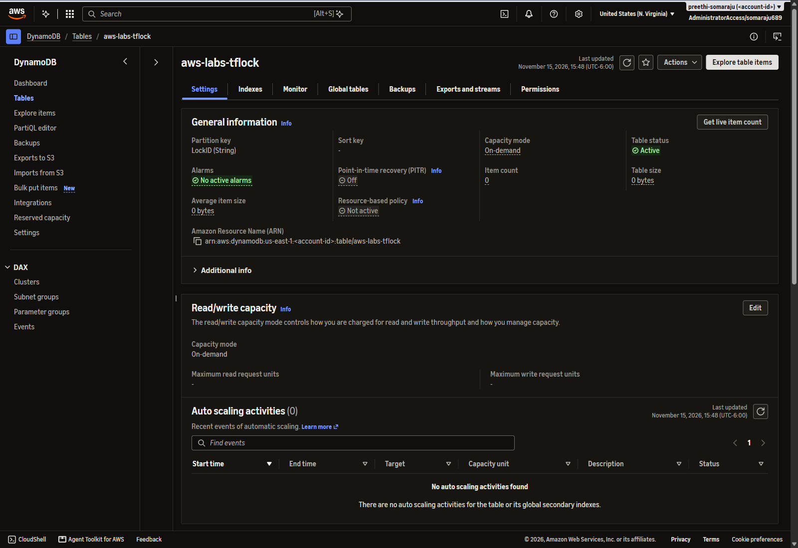

# Lab 01 — Account foundations: budget, state, and locking

## 1. Overview

First lab of a 52-week AWS data engineering series. Before any pipeline exists,
an account needs two things: a limit on what it can cost me, and somewhere
durable to keep Terraform state. This lab builds both, and proves the controls
hold rather than assuming they do.

Everything here is free. The point is not the resources — it is the order they
are created in.

## 2. Problem statement

A new AWS account has no spending limit and no state management. Two failure
modes follow from that.

The first is cost. AWS bills quietly: a NAT Gateway left running is about $32 a
month and announces nothing. By the time a bill arrives, the money is spent.

The second is state. Terraform keeps a record of what it believes exists. Left
on a laptop, that file is a single point of failure — lose it and Terraform
will try to create resources that already exist, or drift from reality without
saying so.

## 3. Objectives and expected outcomes

| Objective | Expected outcome |
|-----------|------------------|
| Spend ceiling with early warning | Budget at $5/month, alerting at 50% actual and 100% forecast |
| Durable, recoverable Terraform state | Versioned, encrypted S3 bucket with public access blocked |
| Safe concurrent applies | DynamoDB lock table, on-demand billing |
| Controls verified, not assumed | Positive and negative tests with recorded output |

## 4. Architecture and design



Three design decisions worth stating.

**The budget is created first.** It is the only resource here whose value is
entirely preventative. Creating it alongside later infrastructure would mean
the first expensive mistake happens before the alarm exists.

**Versioning on the state bucket is not optional.** A corrupted or truncated
state file is recoverable only if a previous version survives. It is the
cheapest insurance in the repo.

**The lock table is on-demand, not provisioned.** State locking is a handful of
writes a week. Provisioned capacity would cost more than the workload justifies
and would need capacity planning for no reason.

## 5. Prerequisites

- An AWS account and AWS CLI v2, authenticated
- Terraform 1.6 or later
- Permission to create budgets, S3 buckets and DynamoDB tables

## 6. Implementation

The budget, with two notifications that are deliberately different in kind:

```hcl
resource "aws_budgets_budget" "monthly" {
  name         = "aws-labs-monthly"
  budget_type  = "COST"
  limit_amount = var.monthly_budget_usd
  limit_unit   = "USD"
  time_unit    = "MONTHLY"

  notification {
    comparison_operator        = "GREATER_THAN"
    threshold                  = 50
    threshold_type             = "PERCENTAGE"
    notification_type          = "ACTUAL"
    subscriber_email_addresses = [var.alert_email]
  }

  notification {
    comparison_operator        = "GREATER_THAN"
    threshold                  = 100
    threshold_type             = "PERCENTAGE"
    notification_type          = "FORECASTED"
    subscriber_email_addresses = [var.alert_email]
  }
}
```

`ACTUAL` at 50% fires on money already spent. `FORECASTED` at 100% fires on
AWS's projection of month-end, and is the more useful of the two: it can fire
on day three, when actual spend is still small but the run-rate implies
trouble.

The state bucket is four resources rather than one, because the AWS provider
splits bucket configuration into separate resources:

```hcl
resource "aws_s3_bucket" "state" {
  bucket = "aws-labs-tfstate-${data.aws_caller_identity.current.account_id}"
}

resource "aws_s3_bucket_versioning" "state" {
  bucket = aws_s3_bucket.state.id
  versioning_configuration { status = "Enabled" }
}

resource "aws_s3_bucket_public_access_block" "state" {
  bucket                  = aws_s3_bucket.state.id
  block_public_acls       = true
  block_public_policy     = true
  ignore_public_acls      = true
  restrict_public_buckets = true
}
```

The account ID is in the bucket name because S3 bucket names are globally
unique across all AWS customers — plain `aws-labs-tfstate` would collide.

Apply output:

```
aws_budgets_budget.monthly: Creation complete after 8s
aws_s3_bucket_versioning.state: Creation complete after 1s
aws_dynamodb_table.lock: Creation complete after 14s

Apply complete! Resources: 6 added, 0 changed, 0 destroyed.
```



## 7. Validation and testing

A successful apply means Terraform's API calls returned success. It says
nothing about whether the controls work. Eight tests: six positive, two
negative.

| # | Test | Expected | Actual | Status |
|---|------|----------|--------|--------|
| T1 | Budget limit | $5.00 MONTHLY | $5.0 USD MONTHLY | Pass |
| T2 | Notifications | 50% actual, 100% forecast | both present | Pass |
| T3 | Block public access | four settings true | four true | Pass |
| T4 | Versioning | Enabled | Enabled | Pass |
| T5 | Encryption | AES256 | AES256 | Pass |
| T6 | Lock table billing | PAY_PER_REQUEST | PAY_PER_REQUEST, ACTIVE | Pass |
| N1 | Public policy rejected | AccessDenied | AccessDenied | Pass |
| N2 | No policy left behind | NoSuchBucketPolicy | NoSuchBucketPolicy | Pass |



The negative test is the one that teaches something. Attempting to attach a
public-read bucket policy:

```
$ aws s3api put-bucket-policy --bucket aws-labs-tfstate-<account-id> \
    --policy file://public.json

An error occurred (AccessDenied) when calling the PutBucketPolicy operation:
User: arn:aws:sts::<account-id>:assumed-role/AWSReservedSSO_AdministratorAccess_.../...
is not authorized to perform: s3:PutBucketPolicy ... because public policies
are prevented by the BlockPublicPolicy setting in S3 Block Public Access.
```

That ran as **AdministratorAccess**. Block Public Access sits above identity
permissions: an administrator cannot grant public access while it is on. The
setting has to be turned off first, which is a separate and auditable action.
That is a meaningfully stronger guarantee than "no policy currently grants
public access."



`LockID` as partition key, on-demand capacity, Active.

## 8. Troubleshooting and challenges

**The negative test passed for the wrong reason the first time.**

*Symptom.* N1 returned a non-zero exit and this:

```
ParamValidation: Unable to load paramfile file:///tmp/public.json:
[Errno 2] No such file or directory
```

*Root cause.* The shell was Git Bash, but `aws` is the native Windows binary,
which does not resolve the MSYS `/tmp` path.

*Resolution.* Used `file://C:/tmp/public.json`.

*Why it is worth recording.* The test was "attaching a public policy should
fail," and the command did fail. Reading the exit code alone, it looks like a
pass. It was not — the control had not been exercised at all. A negative test
only counts when the error returned is the error the test is about, which means
reading the message rather than the exit status.

## 9. Security, cost and operational considerations

**Security.** The state bucket has public access blocked at bucket level,
versioning for recovery, and SSE-S3 at rest. State files contain resource IDs,
ARNs and sometimes secrets, so this is not boilerplate hardening.

The gap: SSE-S3 uses an AWS-managed key, so there is no separate key policy
acting as a second authorisation boundary. A customer-managed KMS key would add
that. Week 4 covers it; pulling it into the bootstrap was not worth the extra
moving part.

**Cost.** Under $0.05 for the lab's lifetime. Budgets are free, the state
objects are kilobytes, and on-demand DynamoDB charges per request.

**Operations.** The bootstrap has a chicken-and-egg problem: this lab creates
the state bucket, so it cannot store its own state there. Its state stays
local. That is the normal pattern — most teams bootstrap the backend this way
and never migrate the bootstrap itself.

**What production would require and this does not have.** Service Control
Policies preventing Block Public Access from being disabled at all,
multi-account separation, CloudTrail with log file validation, and budgets per
cost-allocation tag rather than one account-wide number. None of that is
implemented here.

## 10. Key learnings

Block Public Access overrides identity permissions. Administrator is not a way
around it. That is why it is the correct first control on any bucket, rather
than careful policy writing.

Forecast alerts are more useful than actual alerts. By the time actual spend
crosses a threshold the money is gone; a forecast breach is a warning that
something has started billing.

A test that fails for an unexpected reason is not a passing test. The `/tmp`
path error produced exactly the failure the test was hoping to see, and proved
nothing.

## 11. Cleanup

This lab stays deployed — later labs use the state bucket. To remove it:

```bash
aws s3 rm s3://aws-labs-tfstate-<account-id> --recursive
terraform destroy
```

Versioned buckets refuse to delete while object versions remain, so the empty
step comes first or the destroy fails partway. Verify afterwards with
`aws s3 ls` and `aws dynamodb list-tables`.

## 12. References

- [AWS Budgets best practices](https://docs.aws.amazon.com/cost-management/latest/userguide/budgets-best-practices.html)
- [S3 Block Public Access](https://docs.aws.amazon.com/AmazonS3/latest/userguide/access-control-block-public-access.html)
- [Terraform S3 backend](https://developer.hashicorp.com/terraform/language/backend/s3)
- [DynamoDB read/write capacity modes](https://docs.aws.amazon.com/amazondynamodb/latest/developerguide/HowItWorks.ReadWriteCapacityMode.html)
