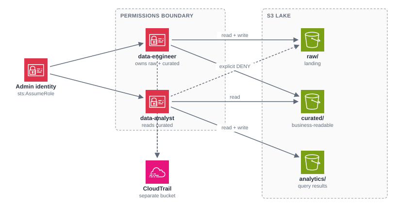
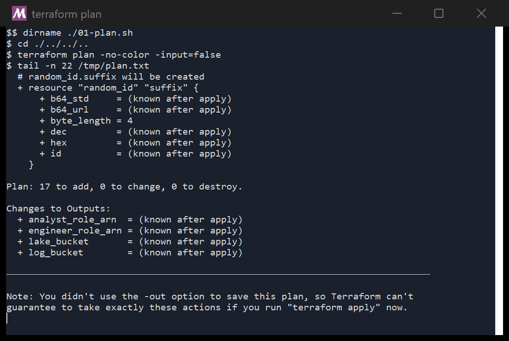
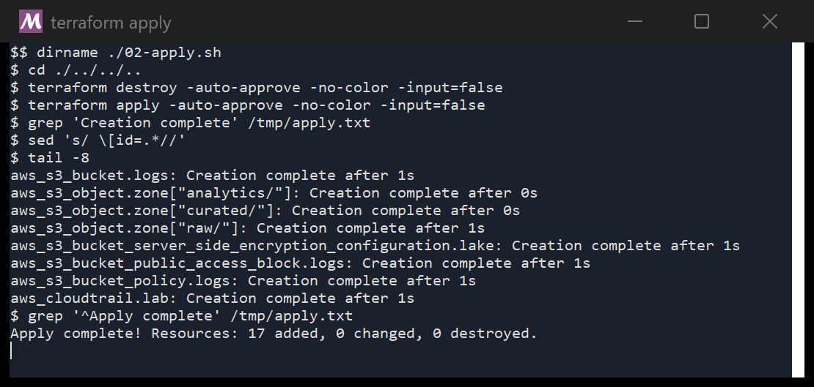
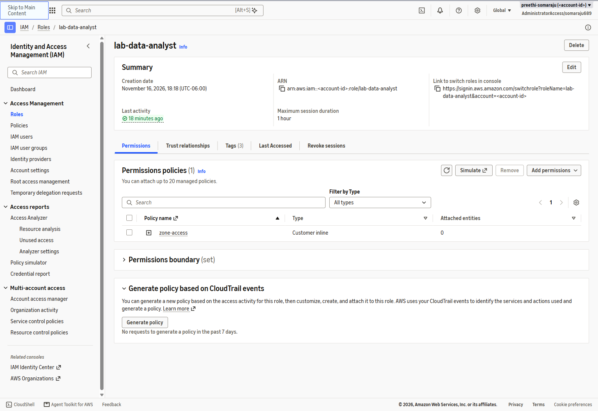
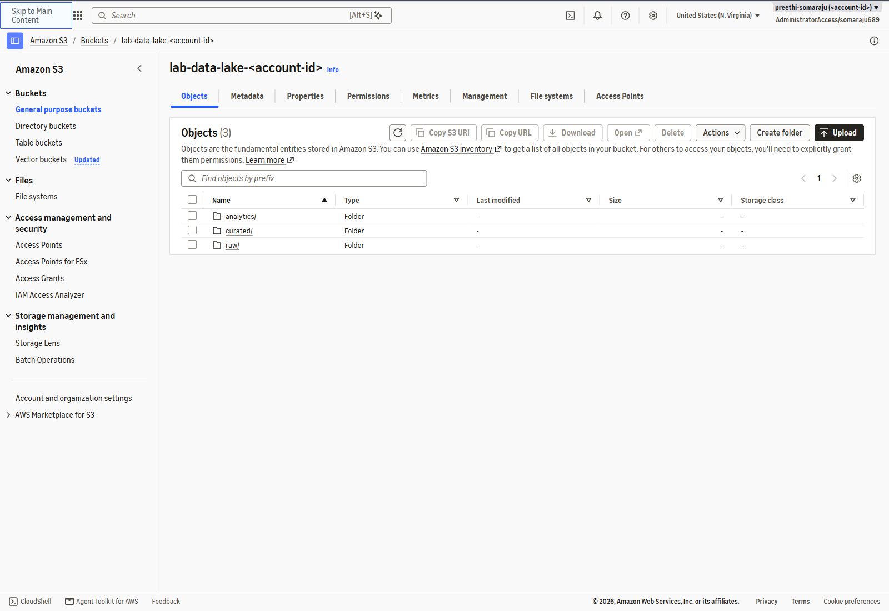
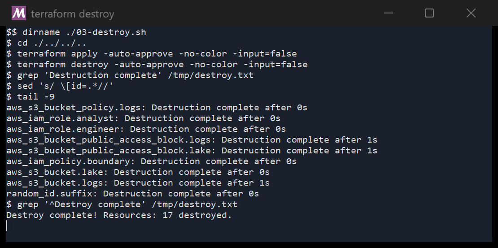
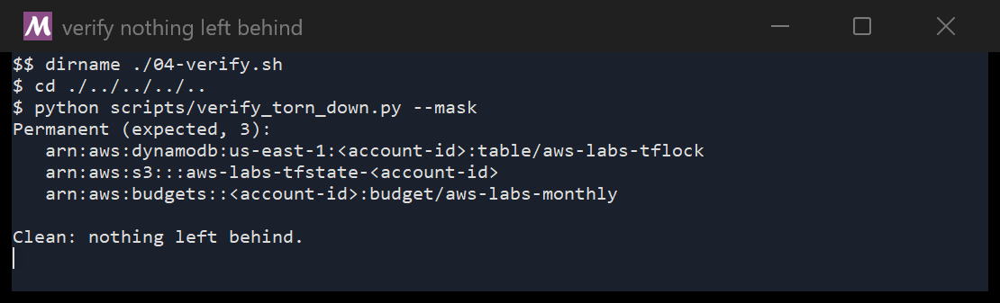

# Lab 02 — IAM for data access: proving the zone boundary holds

## 1. Overview

Second lab of a 52-week AWS data engineering series. A lake has zones — raw,
curated, analytics — and the zones exist because different people should see
different things. Usually that separation is a naming convention. This lab
makes it an enforced control and then tries to cross it.

Cost: under $0.05. Everything was destroyed afterwards and the teardown
verified.

## 2. Problem statement

Raw landing data is unconformed and often carries fields nobody has cleared for
general use. Curated data is the version the business is allowed to read.
Analytics output is where query results land.

With one shared set of credentials reaching all three prefixes, "analysts
cannot see raw data" is a claim with nothing behind it. Nobody can demonstrate
it, and nobody finds out it was false until someone goes looking.

## 3. Objectives and expected outcomes

| Principal | Must succeed | Must be denied |
|-----------|--------------|----------------|
| `lab-data-engineer` | read + write `raw/` and `curated/` | writing `analytics/`; creating IAM users |
| `lab-data-analyst` | read `curated/`, read + write `analytics/` | any read of `raw/`; writing `curated/` |
| either | — | attaching a policy to itself |

Every row became a test.

## 4. Architecture and design



*Figure 1. The engineer owns the path from landing to curated. The analyst
consumes curated and writes only where query results belong. Neither role spans
the whole bucket.*

Four decisions worth stating.

**The analyst can write to `analytics/`.** Athena has to put results somewhere.
A least-privilege design that forgets this produces a role that cannot run a
query — which is how least-privilege attempts actually fail in practice, by
being quietly worked around.

**The engineer cannot write to `analytics/`.** Separation runs both ways, so a
pipeline bug cannot overwrite someone's query output.

**`raw/` is an explicit `Deny` for the analyst, not an absent allow.** An
absent allow is reversed the moment any later policy grants the action. An
explicit deny is not.

**`ListBucket` is constrained by `s3:prefix`.** Without that condition, the
analyst could enumerate `raw/` — leaking schema, volume and naming conventions
— while still being unable to read a single object.

Lake Formation is the right tool for table- and column-level grants and is
deliberately absent: there is no Glue catalog until week 9, so using it here
would mean demonstrating it against nothing.

## 5. Prerequisites

Lab 01 applied (budget alarm, remote state), AWS CLI v2, Terraform 1.6+, and an
identity able to create IAM roles.

## 6. Implementation

The permissions boundary is the part that makes this more than a naive
least-privilege exercise. It caps what either role can ever reach, regardless
of what its own identity policy says:

```hcl
data "aws_iam_policy_document" "boundary" {
  statement {
    sid       = "DataPlaneWork"
    actions   = ["s3:*", "athena:*", "glue:*", "logs:*", "sts:GetCallerIdentity"]
    resources = ["*"]
  }

  statement {
    sid       = "NoIdentitySelfService"
    effect    = "Deny"
    actions   = ["iam:*", "organizations:*", "account:*"]
    resources = ["*"]
  }
}
```

Neither role's identity policy mentions IAM at all. The boundary is what stops
a role granting itself more, and it is attached at role creation:

```hcl
resource "aws_iam_role" "analyst" {
  name                 = "lab-data-analyst"
  assume_role_policy   = data.aws_iam_policy_document.trust.json
  permissions_boundary = aws_iam_policy.boundary.arn
}
```

The analyst's zone access, with the deny written explicitly:

```hcl
statement {
  sid       = "ReadCurated"
  actions   = ["s3:GetObject"]
  resources = ["${aws_s3_bucket.lake.arn}/curated/*"]
}

statement {
  sid       = "WriteQueryResults"
  actions   = ["s3:GetObject", "s3:PutObject", "s3:DeleteObject"]
  resources = ["${aws_s3_bucket.lake.arn}/analytics/*"]
}

statement {
  sid       = "NeverRaw"
  effect    = "Deny"
  actions   = ["s3:*"]
  resources = ["${aws_s3_bucket.lake.arn}/raw/*"]
}
```

CloudTrail writes to a bucket separate from the lake. Mixing them lets a
data-plane compromise erase its own evidence. Management events only — data
events bill per event and are the realistic way to turn a free lab into a
charge.



*Figure 2. `terraform plan` — 17 resources. Every command line in these
terminal figures was printed by bash under `set -x` from the command it was
about to run, so the figure cannot show one command and execute another. The
`.sh` files are committed beside the images in `docs/blog/commands/`.*



*Figure 3. The apply. The three lake zones are visible being created.*



*Figure 4. `Permissions boundary (set)` on the analyst role.*

## 7. Validation and testing

A successful `terraform apply` means Terraform's API calls returned success. It
says nothing about whether the policies do what they claim. Eighteen tests
across two stages.

**Stage one, policy simulation** — `aws iam simulate-principal-policy` answers
"would this be allowed" without creating a single object. Ten cases, all as
expected. The interesting pair:

| Principal | Action | Resource | Result |
|-----------|--------|----------|--------|
| analyst | `s3:PutObject` | `curated/` | **implicitDeny** |
| analyst | `s3:GetObject` | `raw/` | **explicitDeny** |

Writing to `curated/` fails because nothing allows it. Reading `raw/` fails
because something forbids it. The first is reversed by any future policy that
grants more; the second is not. That distinction is the whole reason the deny
is written out rather than left implied.

**Stage two, real calls under assumed sessions** — eight cases confirming the
simulator and reality agree.



*Figure 5. The three zones.*

The evidence that matters, as the analyst:

```
$ aws s3api get-object --bucket lab-data-lake-a1b2c3d4 \
    --key raw/sample.txt /tmp/leak.txt

An error occurred (AccessDenied) when calling the GetObject operation:
User: arn:aws:sts::<account-id>:assumed-role/lab-data-analyst/ana-raw is not
authorized to perform: s3:GetObject on resource:
"arn:aws:s3:::lab-data-lake-a1b2c3d4/raw/sample.txt"
with an explicit deny in an identity-based policy
```

AWS names the mechanism itself: *with an explicit deny in an identity-based
policy*. And listing is refused before any object is touched:

```
$ aws s3 ls s3://lab-data-lake-a1b2c3d4/raw/
An error occurred (AccessDenied) when calling the ListObjectsV2 operation: Access Denied
```

## 8. Troubleshooting and challenges

**A negative test reported a false failure.**

*Symptom.* The analyst-reads-`raw/` check came back as a failure from the
harness:

```
fatal error: An error occurred (403) when calling the HeadObject operation: Forbidden
```

The assertion was looking for `AccessDenied` and did not find it.

*Root cause.* `aws s3 cp` issues a `HeadObject` before the `GET`. A denied HEAD
returns a bare `403 Forbidden` with no reason attached — S3 deliberately does
not explain itself on a HEAD. The access was correctly denied. The assertion
was too narrow.

*Resolution.* Re-ran with `aws s3api get-object`, which performs the GET
directly and returns the full reason. Separately confirmed no file had been
written to disk in either attempt.

*Why it is worth recording.* This is the mirror of the usual trap. The familiar
failure mode is a test that passes for the wrong reason; this one failed for
the wrong reason, and taking it at face value would have meant debugging a
policy that was already correct.

The practical lesson for IAM work: `aws s3` tells you *that* something failed,
`aws s3api` tells you *what stopped it*.

## 9. Security, cost and operational considerations

**Security.** No IAM users and no access keys — roles issue short-lived
credentials, so there is no long-lived secret to leak or rotate. The boundary
sets a ceiling neither role can exceed. CloudTrail's bucket is separate from
the data it audits.

**Cost.** Under $0.05 for the lab's lifetime. IAM and Access Analyzer are free;
the first CloudTrail trail is free for management events. The live risk is
CloudTrail *data* events, which bill per event — explicitly not enabled here.

**Operations.** The trust policy admits the account root, which is right for a
single-account lab and wrong for anything real.

**What production would need and this does not have.** Service Control Policies
so the boundary cannot simply be detached, Lake Formation for table- and
column-level grants, separate accounts per environment, CloudTrail log file
validation feeding an alerting pipeline, and access reviewed on a schedule
rather than only at creation.

## 10. Key learnings

An explicit deny and an absent allow look identical until someone adds a
policy. The simulator distinguishes them — `explicitDeny` versus
`implicitDeny` — and that difference is worth designing around.

Constraining `ListBucket` with `s3:prefix` matters more than it looks. Object
keys leak schema, partitioning and volume. A role that cannot read `raw/` but
can list it still learns a great deal.

Least privilege fails in practice by being too tight, not too loose. An analyst
role that cannot write query results cannot run a query, so somebody widens it
in a hurry and the care is lost. Designing in the write path to `analytics/`
from the start is what keeps the rest of the policy intact.

## 11. Cleanup

```bash
terraform destroy
python scripts/verify_torn_down.py
```



*Figure 6. The teardown. Both roles, the permissions boundary and both buckets
come down.*



*Figure 7. "I ran destroy" and "nothing is left" are different claims. The
verifier checks resources tagged for the series and, separately, the services
that bill whether tagged or not. Only Lab 01's permanent three remain.*

Both buckets use `force_destroy`, because CloudTrail keeps writing for a few
minutes after a trail is deleted and that is the usual reason this kind of
destroy fails partway.

## 12. References

- [IAM policy evaluation logic](https://docs.aws.amazon.com/IAM/latest/UserGuide/reference_policies_evaluation-logic.html)
- [Permissions boundaries for IAM entities](https://docs.aws.amazon.com/IAM/latest/UserGuide/access_policies_boundaries.html)
- [Testing IAM policies with the policy simulator](https://docs.aws.amazon.com/IAM/latest/UserGuide/access_policies_testing-policies.html)
- [Amazon S3 condition keys, including `s3:prefix`](https://docs.aws.amazon.com/AmazonS3/latest/userguide/amazon-s3-policy-keys.html)
- [CloudTrail management and data events](https://docs.aws.amazon.com/awscloudtrail/latest/userguide/logging-management-and-data-events-with-cloudtrail.html)
