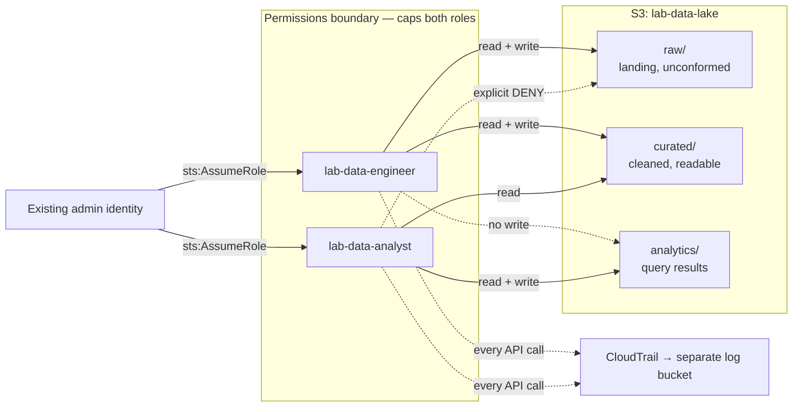

# Lab 02 — IAM for data access: Design (Phase 1)

Status: **design only. Nothing deployed. No resources created.**

## 1. Problem statement

A data lake has zones, and the zones exist because different people should see
different things. Raw landing data is unconformed and often carries fields
nobody has cleared for general use; curated data is the version the business is
allowed to read; analytics output is where query results land.

Usually that separation is a naming convention and an honour system. One shared
set of credentials reaches all three prefixes, so "analysts cannot see raw
data" is a claim with nothing behind it.

This lab makes the zone boundary an enforced control, and proves it by trying
to cross it.

## 2. Objectives

1. Lay out the three lake zones the rest of this series will use.
2. Give the engineer role write access to `raw/` and `curated/`, and nothing
   beyond.
3. Give the analyst role read on `curated/` and write on `analytics/` only —
   because a query engine has to put results somewhere — and no path to `raw/`.
4. Cap both roles with a permissions boundary so neither can grant itself more.
5. Prove every boundary with a negative test rather than an assertion.
6. Produce an audit trail attributing each action to a role session.

## 3. Expected outcomes

| Principal | Must succeed | Must be denied |
|-----------|--------------|----------------|
| `lab-data-engineer` | read + write `raw/` and `curated/` | writing to `analytics/`; creating IAM users |
| `lab-data-analyst` | read `curated/`, read + write `analytics/` | **any** read of `raw/`; writing to `curated/` |
| either | — | attaching a policy to itself (boundary) |

Every row becomes a test case in Phase 3 with recorded command output.

The analyst's denial on `raw/` is the one that matters, and it is written as an
explicit `Deny`. An absent allow is reversed by any later policy that grants
more; an explicit deny is not.

## 4. AWS services required

| Service | Why |
|---------|-----|
| S3 | The lake. One bucket, three prefixes |
| IAM | Roles, identity policies, permissions boundary — the subject of the lab |
| STS | `AssumeRole` is how the roles are exercised |
| CloudTrail | Attribution. Without it, "auditable" is just a word |
| IAM Access Analyzer | Independent check for unintended external access |

Deliberately not used: **Lake Formation**, which does table- and column-level
grants properly and is the right answer once a catalog exists. There is no
catalog until week 9, so using it here would mean demonstrating it against
nothing. It gets its own lab in week 13.

## 5. Architecture and data flow



The engineer owns the path from landing to curated. The analyst consumes
curated and writes only where query results belong. Neither role spans the
whole bucket, and the bucket policy grants nothing on its own — all access
flows through an assumed role.

## 6. Security considerations

- **No IAM users, no access keys.** Roles issue short-lived credentials, so
  there is no long-lived secret to leak or rotate.
- **The permissions boundary is the point.** Without it a role holding `iam:*`
  could grant itself more. The boundary sets a ceiling the identity policy
  cannot exceed, and it is what separates this from a naive least-privilege
  lab.
- **Write separation on `analytics/`.** The analyst writes results there; the
  engineer cannot, so a pipeline bug cannot overwrite someone's query output.
- **CloudTrail's log bucket is separate from the data bucket.** Mixing them
  lets a data-plane compromise erase its own evidence.
- **Management events only.** CloudTrail *data* events on S3 bill per event and
  are the realistic way to turn a free lab into a real charge.

Known limitation: a single account cannot demonstrate SCPs or genuine
cross-account trust. Both belong in the production-perspective section rather
than being faked.

## 7. Cost estimate

| Resource | Cost |
|----------|------|
| IAM roles, policies, boundary | $0 — IAM is free |
| S3 storage (a few test objects, well under 1 MB) | effectively $0 |
| CloudTrail, first trail, management events | $0 |
| CloudTrail log storage | under $0.01 |
| IAM Access Analyzer | $0 |
| **Total** | **under $0.05 for the lab's lifetime** |

## 8. Prerequisites

- Lab 01 applied — budget alarm live, remote state bucket exists
- AWS CLI v2 authenticated; Terraform >= 1.6
- An identity able to create IAM roles and policies

## 9. Deployment and validation strategy

Three stages, each independently verifiable:

1. **Lake and trail** — bucket, three prefixes, public access block,
   CloudTrail. Verify the trail is logging before any role exists.
2. **Roles, policies, boundary** — verified first with
   `aws iam simulate-principal-policy`, which answers "would this be allowed"
   without creating a single object.
3. **Real calls under assumed sessions** — `aws s3 cp` as each role, confirming
   the simulation matches reality. Simulation and practice disagreeing would
   itself be the finding.

Both directions are tested. A `terraform apply` that returns success is not a
passing test, and a command that fails for the wrong reason is not a passing
negative test — every negative case asserts on the error message, not the exit
code.

## 10. Cleanup strategy

```bash
aws s3 rm s3://<lake-bucket> --recursive
aws s3 rm s3://<log-bucket>  --recursive
terraform destroy
python scripts/verify_torn_down.py
```

S3 refuses to delete a bucket that still holds objects, so both are emptied
first. CloudTrail keeps writing for a few minutes after the trail is deleted,
which is the usual reason a destroy fails partway here.

Publication is blocked until `verify_torn_down.py` returns clean.

## Risks identified

| Risk | Mitigation |
|------|-----------|
| CloudTrail data events enabled by accident → real cost | Management events only, stated explicitly in the Terraform |
| Permissions boundary attached to the deploying identity, locking it out | Boundary attached only to the two lab roles |
| Bucket policy too strict, locking the operator out | Access flows through roles; the bucket policy grants nothing extra |
| A negative test failing for the wrong reason, recorded as a pass | Negative tests assert on the error message |
| Trail still writing during destroy | Empty both buckets first, then destroy |

## What this demonstrates, and what production would need

Demonstrated: role-based zone separation, a permissions boundary, explicit
deny, and an audit trail — each verified by trying to cross the line it draws.

Production would additionally need Service Control Policies so the boundary
cannot simply be detached, Lake Formation for table- and column-level grants,
separate accounts per environment, CloudTrail log file validation, and access
reviewed on a schedule rather than only at creation. None of that is
implemented here.

## How this sets up the weeks after it

Week 3 builds the lake properly on these three zones rather than inventing a
layout. Week 9's Glue crawler and week 10's Athena workgroup assume
`analytics/` already exists as the results location, and they run as the roles
defined here rather than as an administrator.

## Approval gate

Phase 2 will not begin until this design is approved. No AWS resources have
been created or modified.
