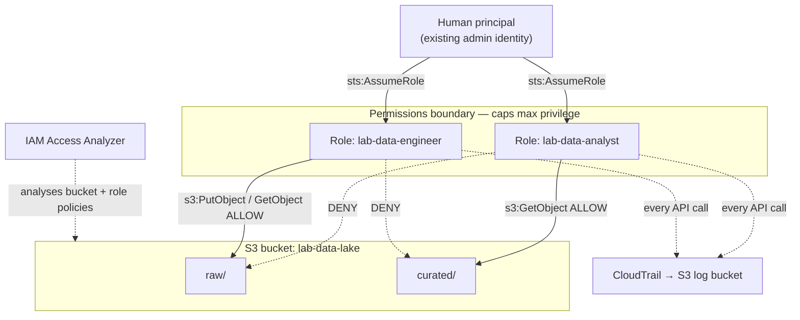

# Lab 02 — IAM Roles & Least Privilege: Design (Phase 1)

Status: **design only. Nothing deployed. No resources created.**

## 1. Problem statement

A small data team shares one AWS account and one S3 data lake. Today everyone
uses the same administrator credentials, so three things are impossible:
attributing an action to a person, limiting what an analyst can reach, and
proving to anyone that those limits hold.

The lab replaces shared admin access with role-based access that is scoped,
auditable, and verifiable — the access model the exam calls least privilege,
built so it can actually be tested rather than asserted.

## 2. Objectives

1. Replace long-lived user keys with assumable roles.
2. Give analysts read-only access to one curated S3 prefix, and nothing else.
3. Give engineers write access to the raw prefix, but not to the curated one.
4. Cap both roles with a permissions boundary so neither can escalate.
5. Prove the boundaries hold with negative tests, not assertions.
6. Produce an audit trail attributing every action to a principal.

## 3. Expected outcomes

| Principal | Should succeed | Should be denied |
|-----------|----------------|------------------|
| Analyst role | `GetObject` on `curated/` | `PutObject` anywhere; any read of `raw/` |
| Engineer role | `PutObject`/`GetObject` on `raw/` | Any access to `curated/`; creating IAM users |
| Either role | — | Attaching policies to itself (boundary blocks) |

Every row above becomes a test case in Phase 3 with recorded evidence.

## 4. AWS services required

| Service | Why it is needed |
|---------|------------------|
| IAM | Roles, policies, permissions boundary. The subject of the lab |
| S3 | The resource access is scoped against; two prefixes |
| CloudTrail | Produces the attribution evidence. Without it, "auditable" is a claim |
| IAM Access Analyzer | Independent check for unintended external access |
| STS | `AssumeRole` is how the roles are exercised |

Deliberately excluded: IAM Identity Center (correct for multi-account, too
heavy for one account and it cannot be fully provisioned in Terraform without
an existing SSO instance), Cognito (end-user identity, not workforce access).

## 5. Architecture and data flow

Flow: a principal calls `sts:AssumeRole`, receives temporary credentials, and
acts against S3 under that role's identity-based policy, intersected with the
permissions boundary and the bucket policy. CloudTrail records the assume and
the subsequent S3 calls under the assumed role session name.

## 6. Security considerations

- **No IAM users, no access keys.** Roles issue short-lived credentials; there
  is no long-lived secret to leak or rotate.
- **Permissions boundary** is the control that distinguishes this from a naive
  least-privilege lab. Without it, a role with `iam:*` could grant itself more.
  The boundary sets the ceiling regardless of what the identity policy says.
- **Explicit deny beats allow.** The analyst's deny on `raw/` is explicit, so
  no later additive policy can accidentally grant it.
- **Trust policy scoping.** Each role trusts only the account's own principals,
  with an `sts:ExternalId` condition to demonstrate the confused-deputy control
  even though it is not strictly required same-account.
- **Bucket public access blocked** at the account and bucket level.
- **CloudTrail log bucket is separate** from the data bucket; mixing them lets
  a data-plane compromise erase its own evidence.

Known limitation: a single-account lab cannot demonstrate SCPs or genuine
cross-account trust. Both are noted in the production-perspective section
rather than faked.

## 7. Cost estimate

| Resource | Expected cost |
|----------|---------------|
| IAM roles, policies, boundary | $0 — IAM is free |
| S3 storage (a few test objects, <1 MB) | effectively $0 |
| CloudTrail — first trail, management events | $0 |
| CloudTrail S3 log storage | <$0.01 |
| IAM Access Analyzer | $0 |
| **Total** | **under $0.05 for the lab's lifetime** |

Risk to watch: CloudTrail *data* events on S3 are billed per event and are NOT
free. This lab enables management events only. Turning on data events for a
busy bucket is the realistic way to get an unexpected bill here.

## 8. Prerequisites

- Lab 00 applied (budget alarm active, remote state bucket exists)
- AWS CLI v2 authenticated to the lab account
- Terraform >= 1.6
- An existing identity with permission to create IAM roles and policies

## 9. Deployment and validation strategy

Three stages, each independently verifiable:

1. **S3 and CloudTrail** — buckets, public access block, trail. Verify the
   trail is logging before any role exists.
2. **Roles and policies** — the two roles, their identity policies, the
   permissions boundary. Verify with `aws iam simulate-principal-policy`
   before touching real objects.
3. **Access Analyzer** — enable, verify zero findings for external access.

Validation is positive *and* negative. Policy simulation is used first because
it answers "would this be allowed" without creating objects; real `aws s3 cp`
calls under assumed sessions then confirm the simulation matches reality.

A successful `terraform apply` is not evidence of anything and will not be
recorded as a passing test.

## 10. Cleanup strategy

`terraform destroy` handles roles, policies, boundary, and Access Analyzer.

Requires manual attention:
- S3 buckets with objects — must be emptied first or destroy fails
- CloudTrail log bucket retains objects after the trail is deleted
- Post-cleanup verification: `aws iam list-roles` shows no `lab-*` roles, and
  `aws s3 ls` shows neither bucket

Destroy will not be run without approval.

## Risks identified

| Risk | Mitigation |
|------|-----------|
| Locking the operator out of their own bucket via a too-strict bucket policy | Bucket policy grants account root; boundary applies only to the lab roles |
| CloudTrail data events enabled by accident → real cost | Management events only; stated explicitly in the Terraform |
| Permissions boundary blocking the apply itself | Boundary is attached to the lab roles, never to the deploying identity |
| Access Analyzer findings from pre-existing account resources | Findings are scoped and read as a baseline before the lab resources land |

## Approval gate

Phase 2 will not begin until this design is approved. No AWS resources have
been created or modified.
