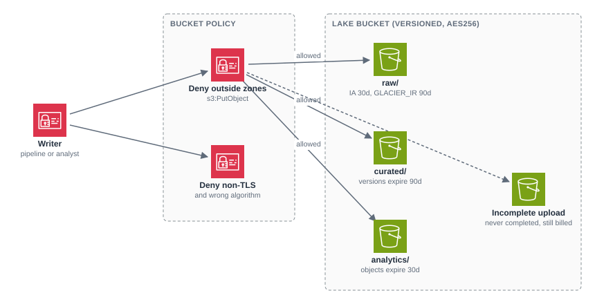
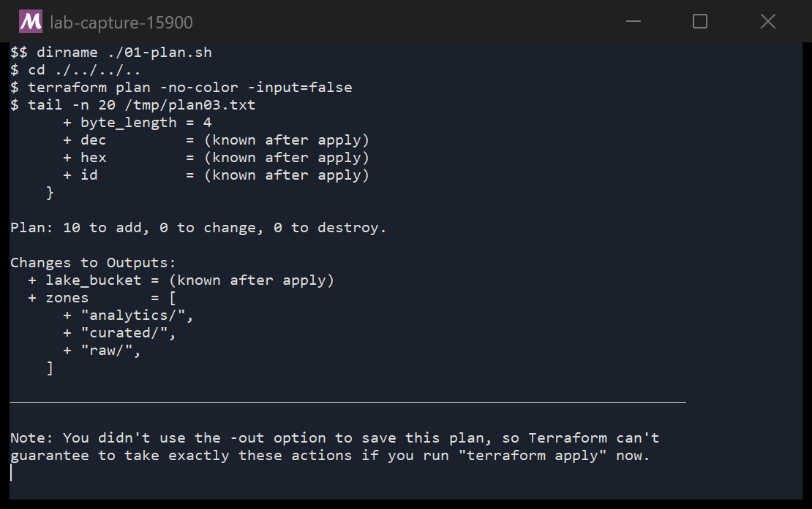
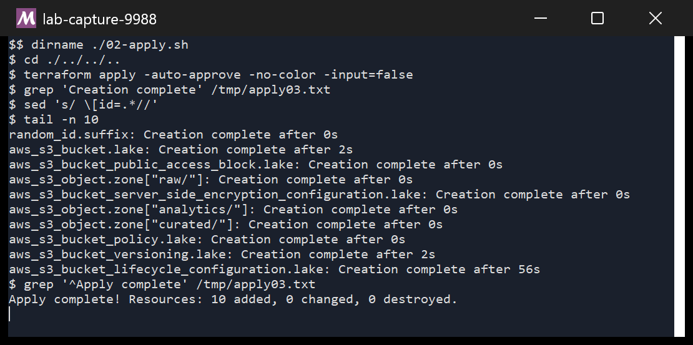
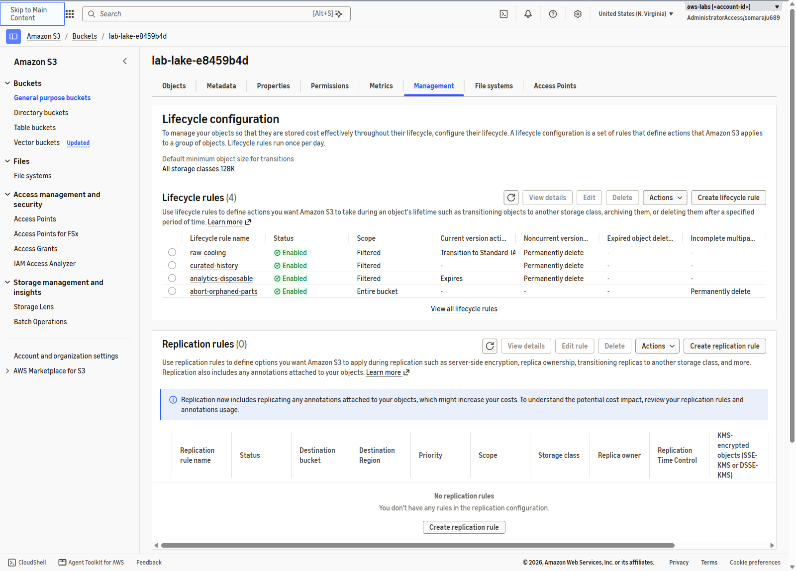
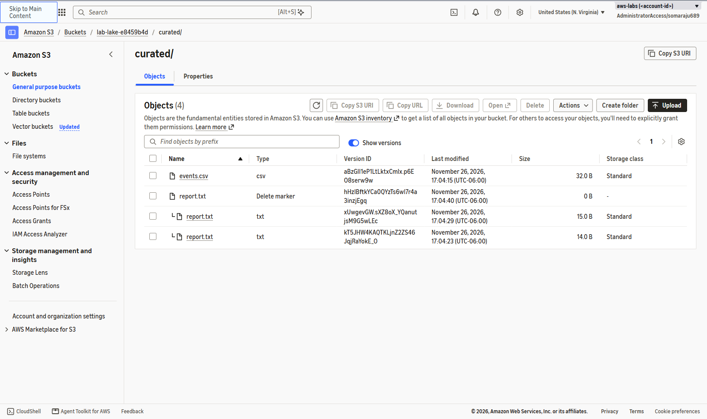
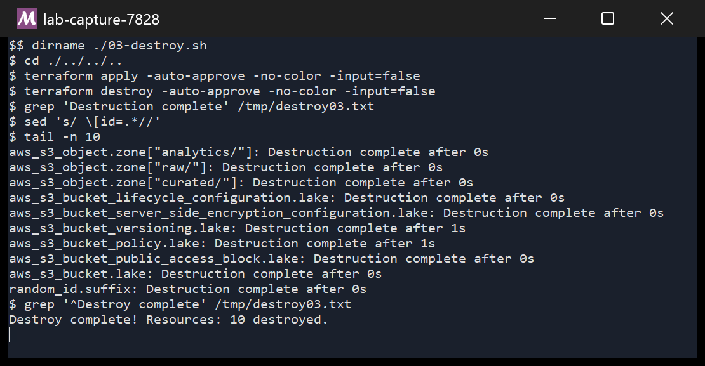
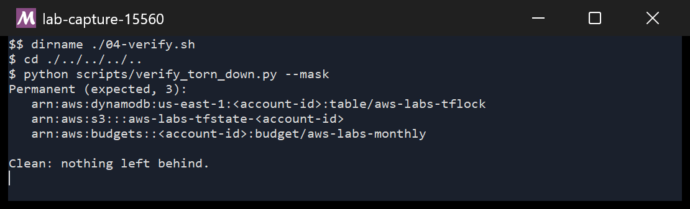

# Lab 03 — S3 as a data lake: a layout you cannot violate, and storage you cannot see

## 1. Overview

Third lab of a 52-week AWS data engineering series. Lab 02 gave two roles
different reach into three lake zones and proved the boundary held. This lab
turns the same zones into something the bucket itself enforces, adds the
lifecycle rules that make a lake affordable, and then finds the storage those
rules exist to catch — storage that is billed and that no object listing will
ever show you.

It also moved house. Everything from here runs in a dedicated `aws-labs`
account rather than the organization's management account.

Cost: under $0.05. Destroyed afterwards and the teardown verified.

## 2. Problem statement

A lake's zones are usually a naming convention. Someone writes the convention
down, everyone agrees, and within a year the bucket has eleven top-level
prefixes and nobody can say which ones are safe to delete.

Lifecycle rules have a sharper version of the same problem. They are the
difference between a lake that costs a few dollars a month and one that costs
a few hundred, so they get added — and because nothing fails at the moment
they are added, nobody finds out until a job that worked for three months
stops working, for reasons set in motion a quarter earlier.

## 3. Objectives and expected outcomes

| Claim | How it is tested |
|-------|------------------|
| Writes land only in the three zones | a write to `scratch/` is refused |
| The data is encrypted regardless of what the client asks for | `head-object` on a headerless upload |
| Plain HTTP cannot reach the bucket | a request to the `http://` endpoint |
| An overwrite is recoverable | read the version the overwrite replaced |
| A delete is recoverable | the object sits behind a delete marker |
| Abandoned uploads are billed and invisible | compared against `list-multipart-uploads` |
| A cold storage class has a reader cost | `GET` an object in Deep Archive |

Thirteen checks. Every row became at least one.

## 4. Architecture and design



*Figure 1. Every write passes the policy gates. The three zones differ in what
happens to data once it is there. The fourth box is not a zone — it is the
remains of an upload that never finished.*

**One bucket, prefixes as zones.** A bucket per zone is the alternative. It
buys independent policy and replication, and costs a cross-bucket copy on
every promotion plus three sets of settings to keep aligned. Prefixes are the
honest choice at this size. What would change that: different retention
regimes per zone, different accounts, or replication to another region.

**The layout is enforced by the bucket, not by the people writing to it.** A
bucket policy denies `s3:PutObject` anywhere outside the three zones.

**Each zone gets the lifecycle its contents justify.**

| Zone | Rule | Why |
|------|------|-----|
| `raw/` | → `STANDARD_IA` 30d, → `GLACIER_IR` 90d | Immutable landing data, read rarely after ingest, kept for reprocessing |
| `curated/` | noncurrent versions expire 90d | Current version stays hot; history is for recovery |
| `analytics/` | objects expire 30d | Query results are derived and reproducible |
| everything | abort incomplete multipart uploads 7d | See section 7 |

**`GLACIER_IR`, not `DEEP_ARCHIVE`.** Deep Archive is around four times
cheaper and cannot be read without a restore that takes hours. For landing
data that exists to be reprocessed, that is not a cost decision, it is a
decision about whether reprocessing still works.

**Small files make lifecycle transitions a loss.** Each transition is a billed
request, and the Glacier classes add roughly 40 KB of metadata per object. For
10 KB files, moving them to Glacier costs more after the move than before.
Lifecycle rules reward a lake with few large objects and quietly punish one
with many small ones — which is also why file size gets its own lab in week 8.

**Where this runs changed.** The first two labs ran in the organization's
management account, because that was the only account there was. That is the
wrong place: Service Control Policies do not apply to the management account,
so nothing there can be contained by the organization's own guardrails, and
lab spend is mixed in with billing. This lab created an `aws-labs` member
account through AWS Organizations and runs there. The management account now
holds the organization, billing and the account-wide budget — and no lab
resources. Free Tier is shared across the organization, so a new account does
not reset it; the separation buys containment and attribution, not allowance.

## 5. Prerequisites

Lab 01 applied in the target account (budget, state bucket, lock table), AWS
CLI v2, Terraform 1.6+, and an identity that can create buckets. Member
accounts created through Organizations come with an
`OrganizationAccountAccessRole` the management account can assume, which is
how Terraform reached the new account before any Identity Center assignment
existed.

## 6. Implementation

The policy statement that makes the zone layout real:

```hcl
statement {
  sid    = "DenyWritesOutsideZones"
  effect = "Deny"
  principals {
    type        = "*"
    identifiers = ["*"]
  }
  actions       = ["s3:PutObject"]
  not_resources = local.zone_arns
}
```

`not_resources` inverts the match: deny any PutObject whose target is not one
of the listed prefixes. Because this is a *resource*-based policy it applies to
every caller — including the identity running Terraform, which is the point.
Lab 02's denials could be removed by editing a role. This one cannot.

The encryption statement is the one worth reading twice:

```hcl
condition {
  test     = "Null"
  variable = "s3:x-amz-server-side-encryption"
  values   = ["false"]          # the header must be present
}
condition {
  test     = "StringNotEquals"
  variable = "s3:x-amz-server-side-encryption"
  values   = ["AES256"]         # and must say AES256
}
```

Both conditions are required, and the `Null` test is not decoration.
`StringNotEquals` evaluated against a key that is **absent** returns true — so
without it, this statement would deny every caller that simply did not send
the header. Negated condition operators and missing keys are a reliable way to
write a policy that does the opposite of what it reads like.



*Figure 2. `terraform plan` — 10 resources. Every command line in these
terminal figures was printed by bash under `set -x` from the command it was
about to run, so a figure cannot show one command and execute another. The
`.sh` files are committed beside the images in `docs/blog/commands/`.*



*Figure 3. The apply. It opens with a `destroy` because the capture tool runs
its script twice — once headless, so the output can be scanned for account IDs
and credentials before any image exists, and once in the window. Starting from
nothing is what makes the visible run a real create rather than a no-op.*

The lifecycle configuration took 56 seconds to create while every other
resource took under three. Nothing is wrong; S3 accepts the configuration and
the provider waits for it to become readable.



*Figure 4. The four rules as S3 stored them. Note what the console says above
them: `Default minimum object size for transitions — All storage classes
128K`. AWS applies that floor itself, because transitioning objects smaller
than 128 KB generally costs more than it saves. The design note about small
files is not a matter of opinion; it is built into the service.*

## 7. Validation and testing

Thirteen checks, all passing. Full output in [TESTS.md](TESTS.md).

**The layout holds, and says so in a new vocabulary:**

```
$ aws s3api put-object --bucket lab-lake-e8459b4d --key scratch/oops.csv ...

An error occurred (AccessDenied) when calling the PutObject operation:
... is not authorized to perform: s3:PutObject on resource:
"arn:aws:s3:::lab-lake-e8459b4d/scratch/oops.csv"
with an explicit deny in a resource-based policy
```

*Resource-based.* Every denial in lab 02 read *identity-based*. The wording is
AWS telling you which thing refused, and it matters: an identity-based deny is
removed by editing the role, a resource-based one is not.

**The copied encryption policy protects nothing.** The statement everyone
pastes denies any PUT without an SSE header. Applied, it does exactly that —
a plain `put-object` gets a 403. But here is the object uploaded earlier by a
command that sent no header at all:

```
$ aws s3api head-object --key raw/dt=2026-11-26/events.csv \
    --query ServerSideEncryption
AES256
```

Since January 2023, S3 encrypts every object at rest whether the caller asks
or not. That statement no longer decides whether data is encrypted. It only
decides whether clients that did not think to send a header get a 403. It is
still worth writing a deny here — but about the *algorithm*, which is what the
version in section 6 does.

**Deleting does not delete:**

```
$ aws s3api get-object --key curated/report.txt out.txt
An error occurred (NoSuchKey) ... The specified key does not exist.
```

The object is not gone. A delete marker is the current version and the data
sits behind it. `NoSuchKey` means "no current version", which is a different
claim from "no object" — and the difference is a recovery procedure.



*Figure 5. The same object with `Show versions` turned on: a 0-byte delete
marker on top, and underneath it both versions — 15 bytes written second, 14
bytes written first. Nothing was lost by either the overwrite or the delete.*

**The finding worth the lab.** A multipart upload was started, one 5 MiB part
sent, and the upload abandoned:

```
$ aws s3 ls s3://lab-lake-e8459b4d/raw/dt=2026-11-26/
2026-11-26 17:04:05         32 events.csv

$ aws s3api list-multipart-uploads --bucket lab-lake-e8459b4d
|  2026-11-26T23:05:12+00:00 |  raw/dt=2026-11-26/big.bin  |
```

That 5 MiB is billed as storage. It appears in no object listing, in no bucket
size, in no S3 Inventory report — because it is not an object yet. Only
`list-multipart-uploads` can see it. A pipeline whose uploads fail partway
accumulates this silently, and the bucket's reported size never moves. The
`abort-orphaned-parts` lifecycle rule exists for exactly this, applies to the
whole bucket, and costs nothing.

**A lifecycle choice is a readability choice:**

```
$ aws s3api get-object --key raw/dt=2026-11-26/cold.csv cold.csv
An error occurred (InvalidObjectState) ...
StorageClass: DEEP_ARCHIVE
```

Had `raw/` been given a Deep Archive transition at 90 days, every reprocessing
job touching data older than a quarter would fail like this — caused by a rule
written three months earlier by someone optimising cost.

## 8. Troubleshooting and challenges

**A test harness that reported "clean" while unable to see anything.** Before
this lab ran, the teardown verifier from week 1 was run against the account.
It reported `Clean: nothing left behind.` The credentials had expired. Every
AWS call it made failed, every failure was swallowed into `None`, and an
account it could not reach was indistinguishable from an account with nothing
in it.

The verifier's entire purpose is to be believed when it says a lab left
nothing behind. It now checks credentials before the passes, raises on any
authentication error, and tracks calls that failed for other reasons as
`INCONCLUSIVE` rather than counting them as clean:

```
$ python scripts/verify_torn_down.py
Cannot verify: Error when retrieving token from sso: Token has expired
Re-authenticate, then run this again. An unverified teardown is not a clean one.
```

Exit code 2. The giveaway, in hindsight, was that it reported **zero**
permanent resources when three were known to exist — a guard that cannot see
the things it is sure about is not reporting on the things it is unsure about
either.

**A figure that showed a no-op.** The first apply capture ended in
`Resources: 0 added`. The capture tool runs its commands twice and the first,
headless run had already created everything. Fixed by destroying at the top of
the captured script, which is why figure 3 opens on a `destroy`.

**The same escaping bug as last time.** One test was written through a quoted
heredoc with a nested `bash -c`, and the backslashes survived into the file
literally, so the command never ran as intended. The run also appeared to stop
after test 10 — that turned out to be `head -80` closing the pipe and killing
the script with SIGPIPE, not a failure. Two different non-failures that both
looked like failures; `cat -A` on the generated file settled the first and the
exit code settled the second.

## 9. Security, cost and operational considerations

Block Public Access on, versioning on, TLS required, encryption algorithm
enforced, and a bucket policy that applies to every principal rather than to
the roles someone remembered to restrict.

The costs that matter here are not storage. They are: noncurrent versions
accumulating with no expiry rule (versioning without lifecycle is a slow
leak), abandoned multipart parts, and lifecycle transitions applied to small
objects, where the per-object request and metadata overhead exceed the saving.

Not implemented: S3 Inventory, which takes up to 48 hours to produce its first
report and would outlast the lab; Object Lock, which can only be enabled at
bucket creation; replication; and access logging, which belongs with the
CloudTrail work from lab 02.

## 10. Key learnings

Resource-based and identity-based denials are different instruments, and AWS
names which one fired in the error text. Identity policy describes what a role
may do. Bucket policy describes what the bucket accepts. The second survives
someone editing the first.

A negated condition operator with a missing key evaluates to true. That single
fact turns a correct-looking encryption policy into one that denies everybody,
and it is why the `Null` test sits beside the `StringNotEquals`.

The S3 trap that costs real money is not a storage class. It is an upload that
was never completed: billed, unlisted, invisible to every tool that counts
objects, and removable by one lifecycle rule that takes four lines.

And a guard that cannot fail loudly is not a guard. The verifier reported a
clean account while holding expired credentials, and would have kept doing so
after every future lab.

## 11. Cleanup

```
$ terraform destroy -auto-approve
Destroy complete! Resources: 10 destroyed.

$ python scripts/verify_torn_down.py
Permanent (expected, 3):
   arn:aws:dynamodb:us-east-1:<account-id>:table/aws-labs-tflock
   arn:aws:s3:::aws-labs-tfstate-<account-id>
   arn:aws:budgets::<account-id>:budget/aws-labs-monthly

Clean: nothing left behind.
```



*Figure 6. The teardown. It re-applies first, for the same reason figure 3
destroys first — the capture runs its script twice, and the count has to be
real.*



*Figure 7. The check that has to be believed. Three permanent resources named,
nothing else found.*

The verifier makes two passes: everything tagged `Project=aws-labs`, and the
services that bill whether tagged or not. Lab 01's three resources are
permanent by design. One object in this lab was written to `DEEP_ARCHIVE`,
which carries a 180-day minimum billing commitment — on roughly 1 KB that is a
fraction of a cent, but it is the kind of commitment worth knowing you have
made before making it at scale.

## 12. References

- [Using bucket policies](https://docs.aws.amazon.com/AmazonS3/latest/userguide/bucket-policies.html)
- [Amazon S3 condition keys](https://docs.aws.amazon.com/AmazonS3/latest/userguide/amazon-s3-policy-keys.html)
- [Managing the lifecycle of objects](https://docs.aws.amazon.com/AmazonS3/latest/userguide/object-lifecycle-mgmt.html)
- [Using versioning in S3 buckets](https://docs.aws.amazon.com/AmazonS3/latest/userguide/Versioning.html)
- [Multipart upload overview](https://docs.aws.amazon.com/AmazonS3/latest/userguide/mpuoverview.html)
- [Default encryption for S3 buckets](https://docs.aws.amazon.com/AmazonS3/latest/userguide/default-bucket-encryption.html)
- [Best practices for the management account](https://docs.aws.amazon.com/organizations/latest/userguide/orgs_best-practices_mgmt-acct.html)
